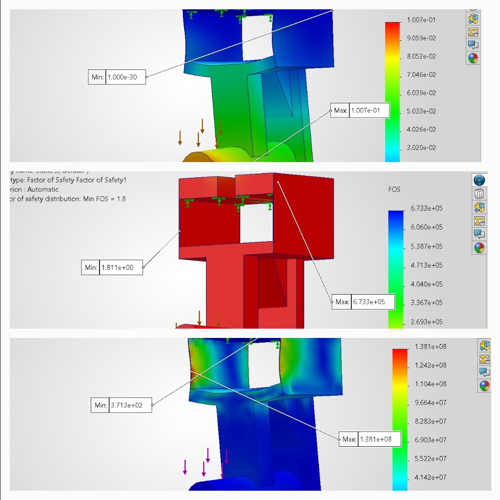

# A7 – FEA on Bracket

## Objectives:
**-** Use Finite Element Analysis (FEA) to improve the bracket design from previous assignments.

**-** Ensure high stiffness, strength, and lightweight optimization through iterative design.

**-** Conduct multiple FEA simulations, refining geometry based on results.

**-** Perform static stress analysis, including constraints, loading, and meshing selection.

**-** Interpret data by identifying max stress, displacement, and safety factors.

**-** Optimize the design by modifying geometry to enhance performance.

**-** Document the entire process with images, calculations, and insights.

**-** Reflect on key engineering lessons learned and time spent.

## Description:
Your task is simply to create a high stiff, high strength, and lightweight component. Use Finite Element analysis to drive your decision making process throughout your design. Each step of the analysis and before you make geometric changes make sure the component’s results (stress/displacement/Safety Factor) converge on a 7% difference. Achieve this by modifying the number of elements. If after three attempts to converge use the stiffness and stress from the finer mesh size use the finest mesh size and proceed through the process.

## Initial Design
I will be using my same bracket design and CAD file from my A6 assignment. Here below I am speficifying my material, this is the material that I based all of my calculations on for the previous assignments. 

## Design 1
**-** This initial design from A6. I have not modified anything from the previous assignments. 

I double checked that my parametric equations were still applied from last time as well!

### Adding Parameters
First I decided to apply my fixed position to the bottom of the top flanges, this will simulate this bracket being slided onto something with a load of the bottom. 

Here I added the downward force of 275lbf. This is the force I used to make all of my calculations, which comes from the chose force of P=550lbf. My force values came from P=F/2. 

After the force was added, I created a mesh of the ENTIRE part. 

## Work Flow
For each design I ran the simulations 3 times. I started with a smaller element value and increased each time. I combined a photo of all 3 for each run, just to make things easier to read for viewers. For each design I created a chart showing all values.
Here below is how I adjusted each mesh value.

 

### Design 1
#### D1-1

#### D1-2

#### D1-3

#### D1-Resulting Data

#### Discussion about data/changes
...

### Design 2

#### D2-1

#### D2-2

#### D2-3

#### D2-Resulting Data

#### Discussion about data/changes
...

### Design 3

#### D3-1

#### D3-2

#### D3-3

#### D3-Resulting Data

#### Discussion about data/changes
....

## Additional Changes
### Design 4...

#### D4-1

#### D4-2

#### D4-3

#### D4-Resulting Data

#### Discussion about data/changes
....

## Reflections:

