# A9 – Pulley System Design 

## Objective
Design a pulley system to transfer power between two parallel axes separated by a center distance of 4–6 inches. The system must meet the following requirements:

**-** Pulley Diameter: Both pulleys shall have a diameter of 3 inches.
**-** Rotational Speed: Select an operating speed between 1000–2000 rpm.
**-** Belt Tension (Static): Select a belt tension between 4–6 lbf under stationary conditions.
**-** Material: Pulleys may be made from aluminum, ABS, or steel, and may include a groove and shaft diameter of your choosing (within reasonable manufacturing limits).
**-** Safety Factor: The design must satisfy a minimum safety factor of 3.
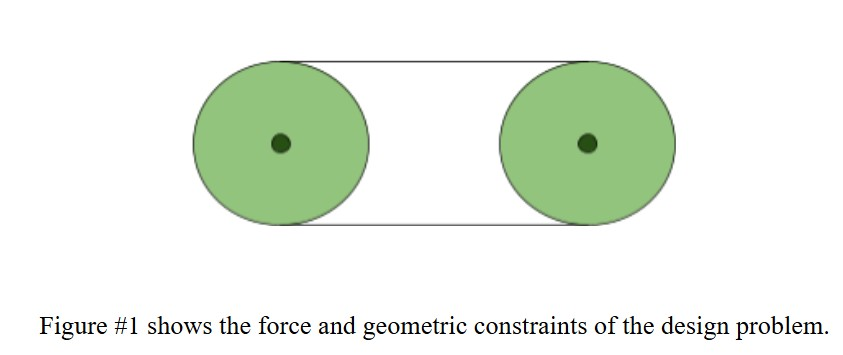

## Belt Design

### Knowns and Unknowns:
For this assignment and like all in the past I started with listing my knowns and unknowns. This helps me understand which variables I have and which equations I could potentially use to solve for my unknowns. 
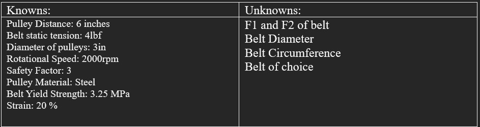
### FBD:
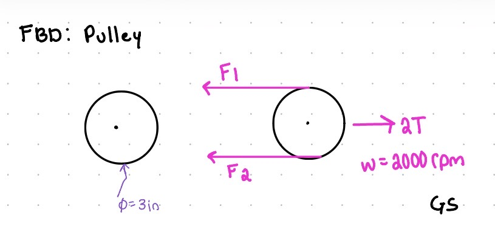
### Symbolically Solving:
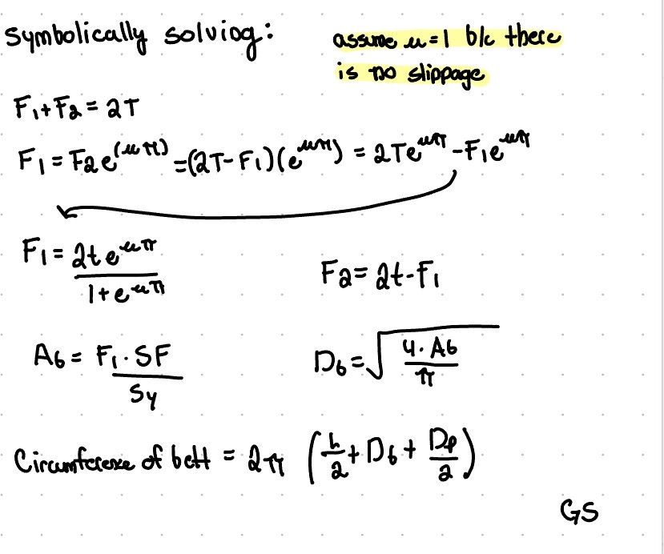
### Numerically Solving:
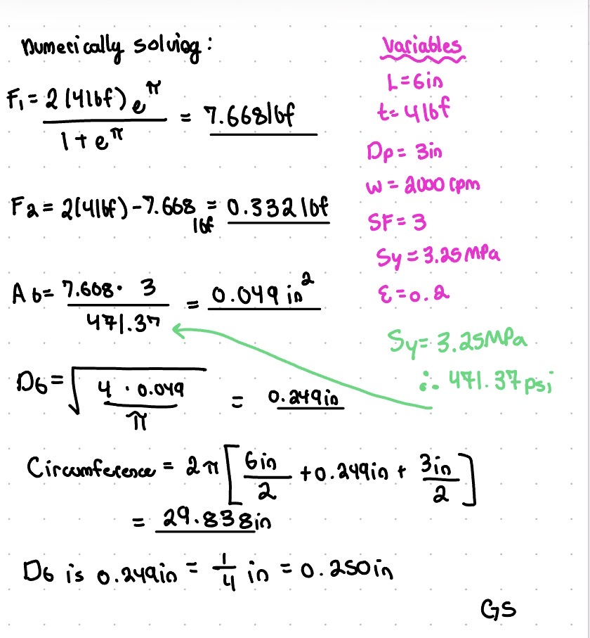

### Belt Choice:
For the selection of the belt I took my circumference value and cross sectional area value and converted those to fractions. From there I went to McMaster and selected a basic O ring as my belt and used the dimensions I solved for to find one. After filtering I finnaly found one I like and that would work for my calculations. 
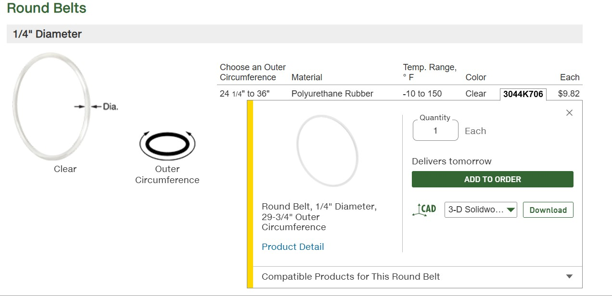

## Shaft Design
For the shaft I followed the exact same work flow...
### Knowns and Unknowns:
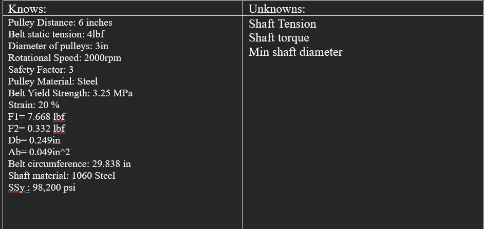
### FBD:
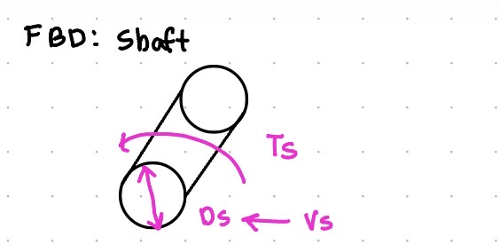
### Symbolically Solving:
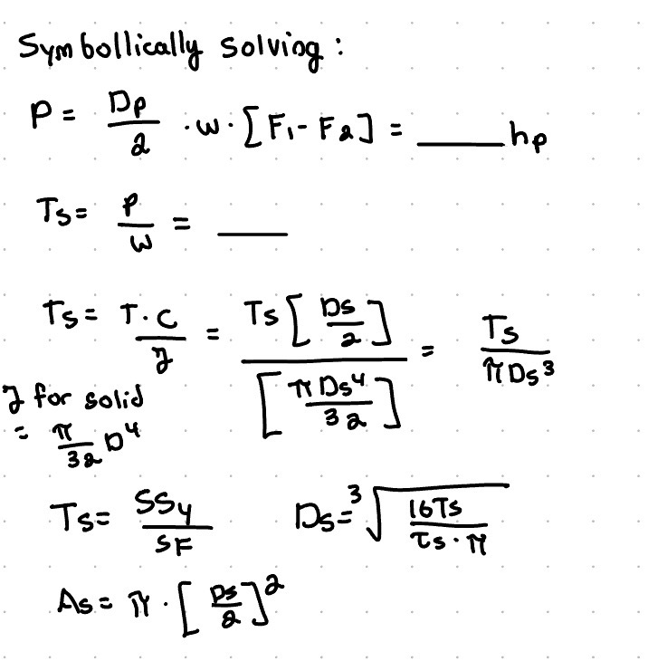
### Numerically Solving:
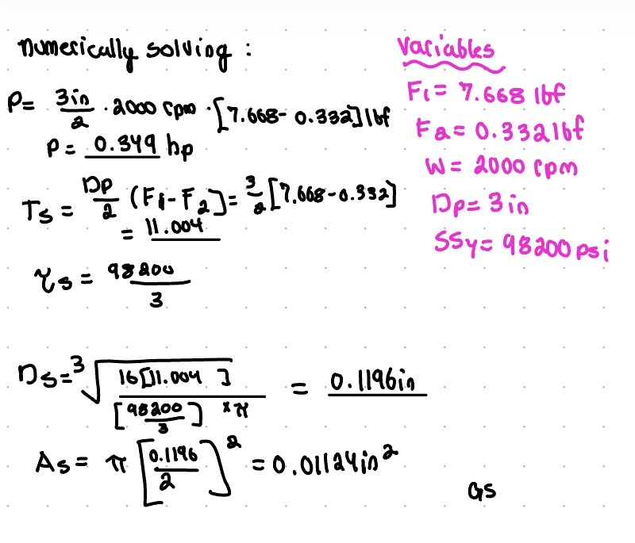

## Journal Bearing Design
I also did the exact same work flow for the journal bearing...
### Knowns and Unknowns:
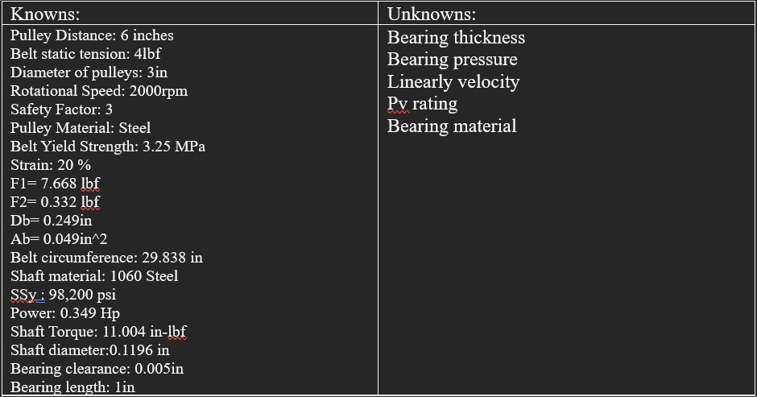
### FBD:
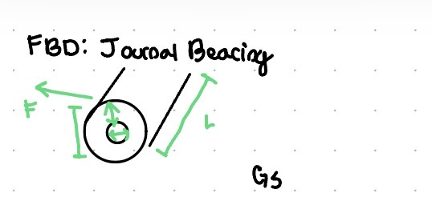
### Symbolically Solving:
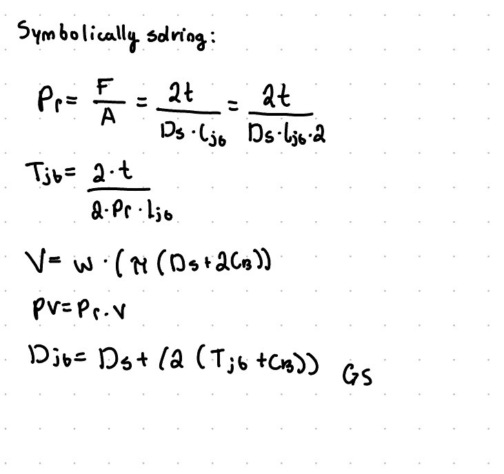
### Numerically Solving:
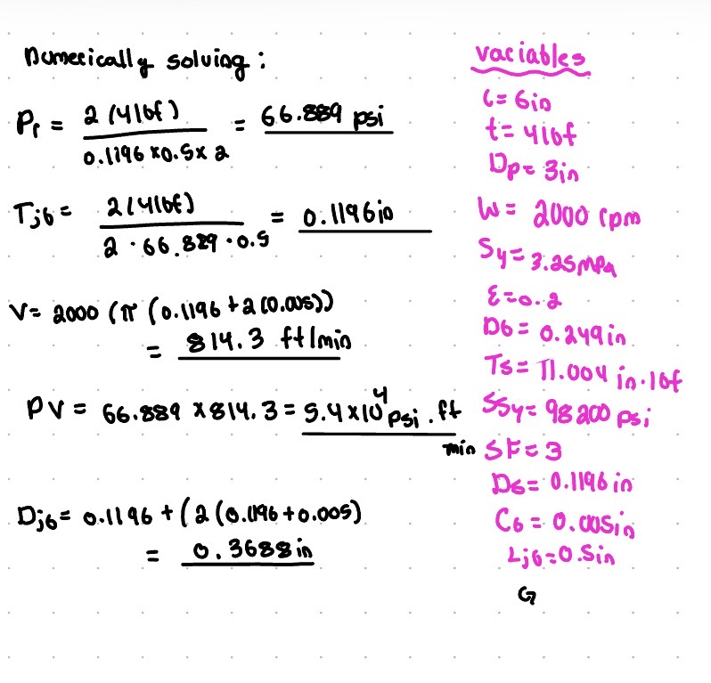
### Material Selection:

For this assignment I will choose based on table 4 is porous bronze. This is the primary match based on my calculations. 

## Frame Design:
For this part of the assignment I let my curriosity drive. I went to home depot for something not relevant here and I came across a mini pulley. Naturally I bought it and it's inspired me for my frame design. Althought this is a single pulley I am going to take some of the structural features and use it. 
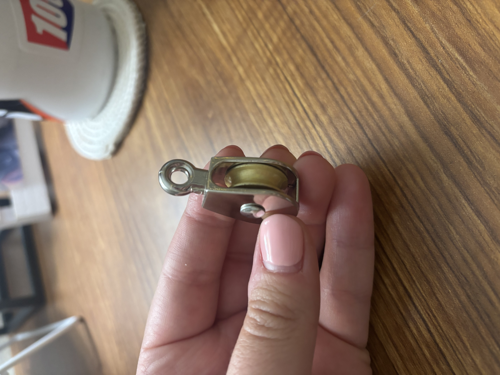

My Frame Design:
I have absolutely no idea what this pulley is being used for so I will ignore any and all enviormental factors for this part. I would have loved to throw this in CAD, I just didn't have time so I drew it by hand! 
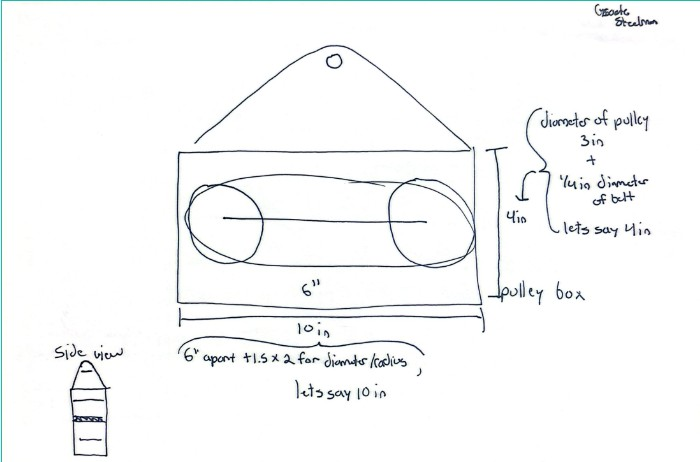

## Lessons Learned
I think this assignment has been my favorite thus far in the semester. Many everday systems we use have pulleys in them. I also learned more applications of the core principles of physics. Althought we only solved for the forces listed I can't help but wonder all of the other ones we ignored. I also learned how belt tensions interacts as stress on pulleys. This assignment took me around 6 hours to complete. I also learned more about the PV rating and what it means. 
