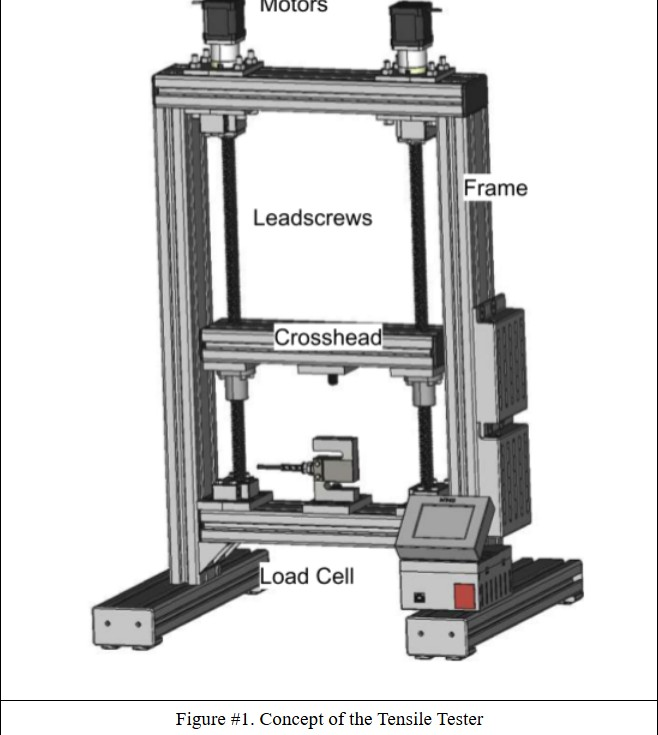
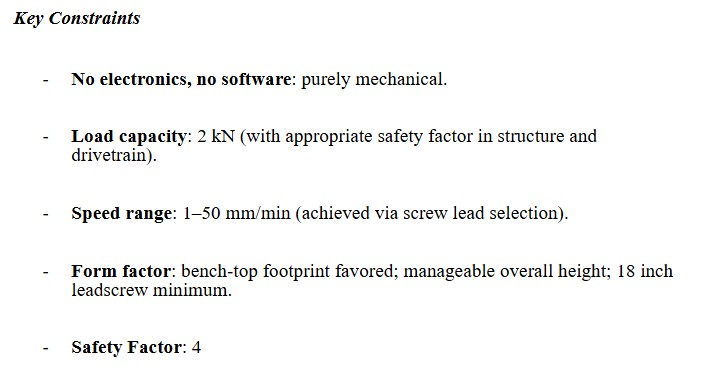
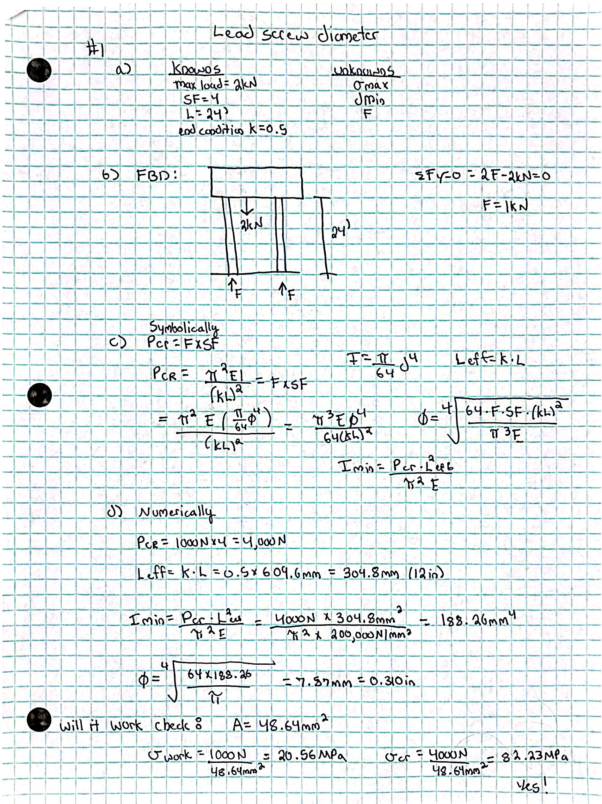
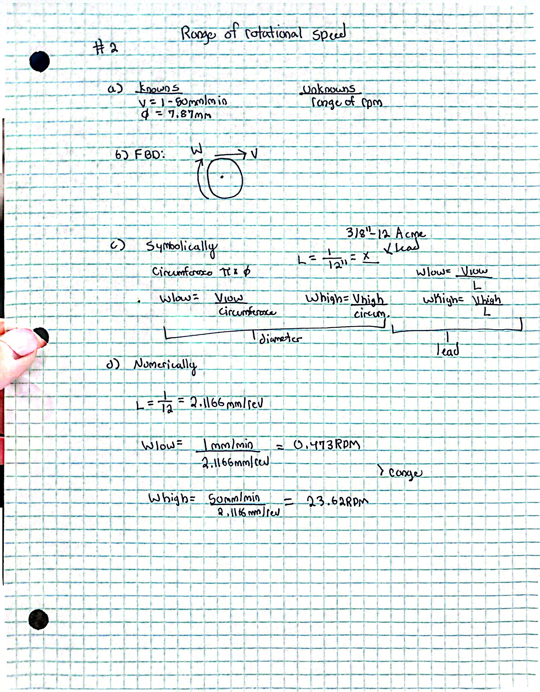
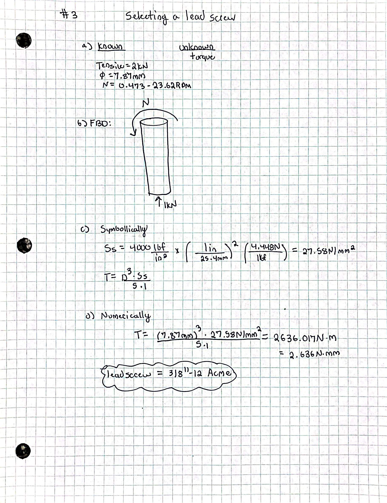
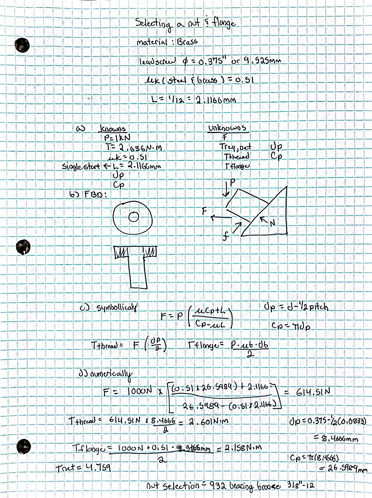
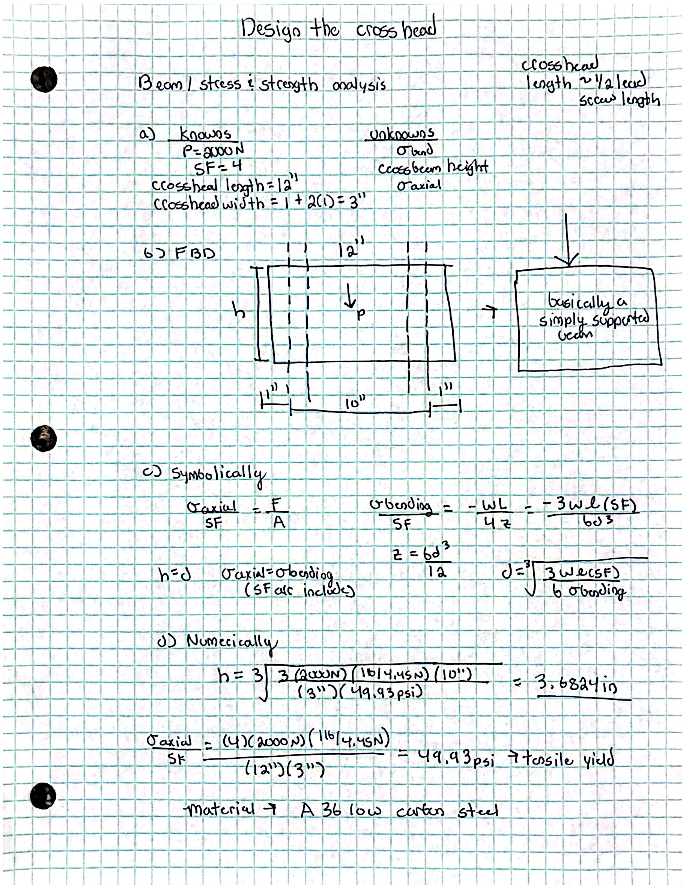
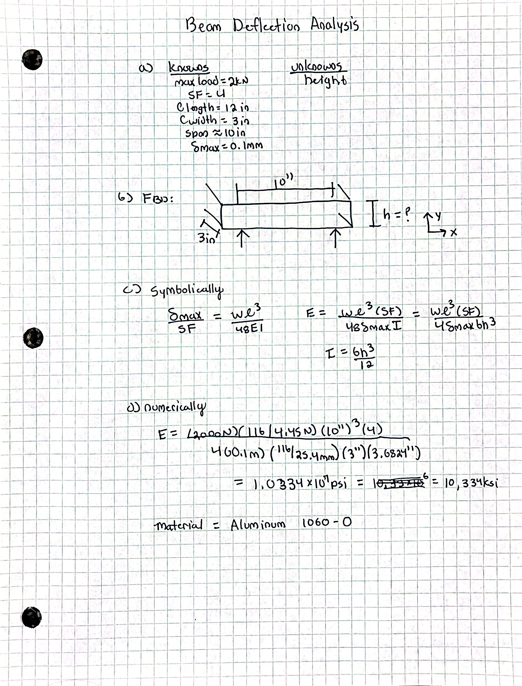
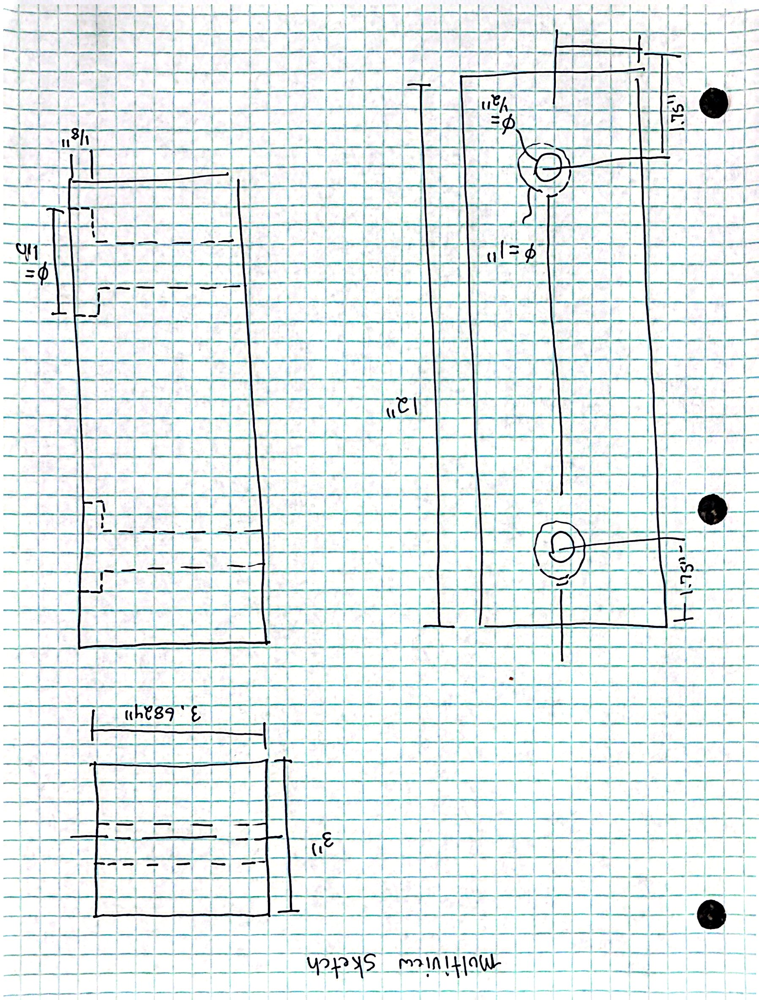

# A10 – Lead Screw Translating System Design - Group Project

### Group members:

**-** Gracie Steelmon

**-** Kaileigh Hill

**-** Kelsey Skipper

## Objective

## Leadscrew Diameter (Gracie Steelmon)

### 1.) Diameter

**-** Determine the minimum diameter of the lead screw using axial stress. Note there are two lead screws and use the safety factor listed.

### 2.) Rotational speed range

**-** Determine the range of rotational speed given the linear speed.

### 3.) Select a Lead Screw

**-** Select a lead screw by determining max torque to provde the 2kN tension to the test sample. 

### 4.) Lead Screw Selection 
For this assignment we will be selecting the 1018 Carbon Steel Percision Acme Lead screw that is right handed and is 3/8"-12. We specifically chose the 3' knowing we are going to have to cut about an inch off. This does cause the price to increase, but the only other option for this was 18" which is way too short. 

## Nut and Flange Selection (Gracie Steelmon) 
**-** Analyze the internal threads of the nut to select a proper bronze nut/flange. 
 

## Design the Crosshead (Gracie Steelmon) 

### 1.) Stress/Strength Analysis 

### 2.) Beam Deflection Analysis

### 3.) Multiview Drawing

## Talbulating Cost

| Item Number  | Quantity |  Name | Cost per Item | Net cost | Purchase Link |
| -------------- | ------------- | -------------- | -------------- | -------------- | -------------- |
| 1 | 2 | 1080 Carbon Steel Lead Screw: Right hand: 3/8"-12: 3' | $35.32 | $70.64 | https://www.mcmaster.com/99030A993/ |
| 2 | 2 | Acme bronze flange nut: Right hand: 3/8"-12 | $111.78 | $223.56 | https://www.mcmaster.com/95120A592/ | 
| 3 | 1 | T-slot framing system | $245.87 | $245.87 | https://www.grainger.com/product/80-20-T-Slot-Framing-System-Rectangle-804T48 |
|   |   |                       | Net Cost: | $540.07 | |

## Lesson Learned:
From this assignment I have learned how to apply all of the equations and concepts we have learned in the semester thus far. This took me around 5 hours to complete all of the calculations.
